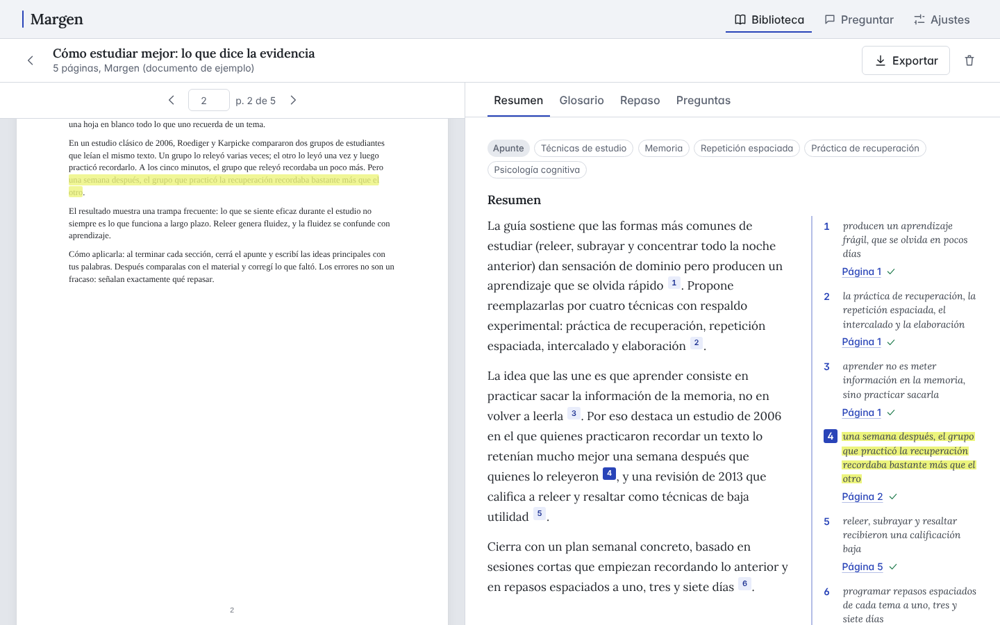
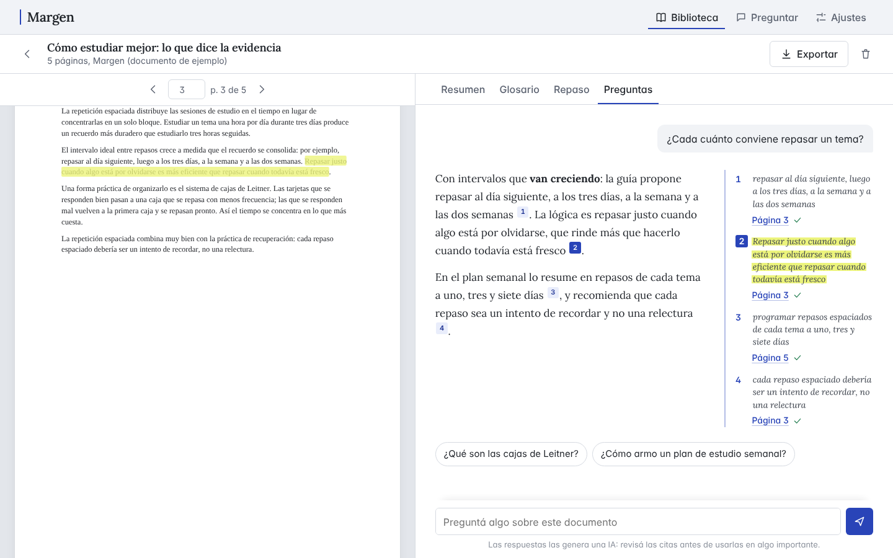

# Margen

**Leé, resumí y preguntale a tus PDFs, con la página exacta de cada cita.**

Margen es una aplicación web para estudiar y trabajar con documentos largos: apuntes, papers, manuales, contratos o leyes. Subís tus PDFs y te arma un resumen con fuentes, un glosario y preguntas de repaso con repetición espaciada. Además responde lo que le preguntes sobre uno o varios documentos a la vez. Cada cita se compara con el texto original y se resalta dentro del PDF, para que sepas cuándo podés confiar en la respuesta.

**[Abrir Margen →](https://Fran951xD.github.io/margen/)**: tocá "Probar con un documento de ejemplo" para verlo funcionar sin clave.



## El problema

Las herramientas de IA para documentos suelen responder con seguridad aunque estén equivocadas, y rara vez muestran de dónde sale cada afirmación. Para estudiar o revisar un contrato eso no alcanza: necesitás ver la frase original.

Margen está diseñado alrededor de esa necesidad:

- **Cada afirmación lleva una cita** con documento y página, como una nota al margen.
- **Las citas se verifican**: el extracto que da la IA se busca en el texto real de la página. Si coincide, se marca como verificado. Si no aparece, se marca en ámbar para que desconfíes.
- **Al tocar una cita**, el visor salta a la página y resalta en amarillo las palabras exactas dentro del PDF.
- **Si la respuesta no está en los documentos, lo dice** en lugar de inventar.

## Qué hace

| | |
|---|---|
| **Biblioteca** | Arrastrás PDFs (hasta 60 MB). Lee el texto de cada página, detecta las escaneadas y soporta PDFs con contraseña. |
| **Resumen con fuentes** | Resumen breve, normal o detallado, puntos clave con su página, temas y preguntas sugeridas. Se exporta a Markdown con notas al pie. |
| **Glosario** | Términos técnicos y siglas definidos como los usa el documento, con buscador. |
| **Repaso** | Cuestionario de opción múltiple con explicación y las páginas a repasar. Tarjetas con repetición espaciada (sistema Leitner: 1, 3, 7, 16 y 35 días). |
| **Preguntas** | Chat sobre un documento o varios a la vez, con historial, preguntas de seguimiento y citas verificadas. |
| **Páginas escaneadas** | Las páginas sin texto se mandan como imagen a Gemini para transcribirlas, y después entran en búsquedas y resúmenes. |
| **Sin conexión** | La app se instala como PWA. Los documentos, resúmenes y tarjetas se pueden consultar sin internet. |



## Cómo funciona

```
PDF ──► pdf.js (en el navegador) ──► texto por página ──► IndexedDB
                                                          │
Pregunta ──► ¿entra todo en el contexto? ── sí ──► todas las páginas ─┐
                     │                                                 │
                     no ──► búsqueda BM25 local ──► fragmentos ────────┤
                                                                       ▼
                                Gemini (salida JSON con esquema: respuesta + citas)
                                                                       │
                    validar citas: ¿documento y página existen? ¿el extracto está en la página?
                                                                       │
                                     respuesta con notas al margen + resaltado en el PDF
```

Algunas decisiones de diseño:

- **Sin servidor.** Todo corre en el navegador. Los PDFs se guardan en IndexedDB y la clave de Gemini en `localStorage`. Solo el texto necesario viaja a Google.
- **Contexto completo cuando entra.** Los modelos Flash de Gemini aceptan contextos muy largos, así que en documentos normales se manda el texto entero, que da mejores respuestas que recortar. Para bibliotecas grandes, un índice **BM25** local elige los fragmentos más relevantes, sin costo de API.
- **Los fragmentos nunca cruzan de página**, así cada cita apunta a una sola.
- **Salida estructurada.** Gemini responde JSON con un esquema (texto con marcas `[n]` y lista de citas). Margen descarta las citas a páginas inexistentes, renumera las válidas y verifica cada extracto: coincidencia exacta, aproximada (80% de las palabras y una secuencia de al menos 4 seguidas) o no encontrada.
- **Resistente a fallas.** Reintenta los cortes momentáneos (429/5xx) respetando el `retryDelay` de Google. Si un modelo no existe o agotó el cupo diario, prueba con el siguiente. Si la API rechaza el formato nuevo de salida estructurada, usa el anterior.
- **El texto de los documentos es material, no instrucciones**: la instrucción de sistema le pide al modelo ignorar pedidos que aparezcan dentro de un PDF (defensa básica contra inyección de prompts).

## Usarlo

1. Abrí la app y tocá **Ajustes**.
2. Sacá una clave gratis en [Google AI Studio](https://aistudio.google.com/apikey) (Create API key).
3. Pegala y tocá **Guardar y probar**. Margen elige el mejor modelo disponible para tu clave.
4. Volvé a la **Biblioteca** y subí tus PDFs.

Para instalarla en el celular: en Android, menú ⋮ → **Instalar app**. En iPhone, **Compartir** → **Agregar a inicio**.

### Privacidad

- No hay servidor de Margen: nada se guarda fuera de tu navegador.
- Al resumir o preguntar, el texto del documento se envía a la API de Gemini.
- En el nivel gratuito, Google puede usar ese contenido para mejorar sus productos. No subas documentos confidenciales salvo que tengas la facturación activada en tu proyecto de Google.

## Desarrollo

No necesita instalar dependencias ni compilar. Son módulos ES nativos.

```bash
python3 -m http.server 5174     # o: npm run dev
# abrir http://localhost:5174
```

### Pruebas

```bash
npm test             # 20 pruebas unitarias (Node, sin dependencias)
npm run test:e2e     # pruebas punta a punta con Playwright y Gemini simulado
```

Las pruebas punta a punta interceptan la API de Gemini, así que no gastan cupo ni necesitan clave. Recorren todo el flujo:

- clave inválida y válida;
- subir un PDF con una página escaneada y leerla con IA;
- resumen con respaldo de formato, descarte de citas inválidas y resaltado en el PDF;
- pregunta con reintento tras un 429 y cita no verificada;
- exportar, preguntar a varios documentos, persistencia al recargar y borrado.

### Estructura

```
index.html
css/margen.css            estilos (sin frameworks)
js/
  logica.js               lógica pura: fragmentos, BM25, prompts, esquemas, verificación de citas,
                          markdown seguro, repaso espaciado (probada con Node)
  gemini.js               cliente REST de Gemini: modelos, reintentos, respaldo de modelo y de formato
  lector.js               pdf.js: texto, dibujo de páginas, capa de texto, imagen para OCR
  resaltar.js             ubica un extracto dentro de la capa de texto del PDF
  db.js                   IndexedDB (transacciones atómicas) y ajustes
  servicio.js             casos de uso: importar, leer escaneadas, analizar, glosario, repaso, preguntar
  demo.js                 resultados del documento de ejemplo (citas verificadas por las pruebas)
  vistas/                 biblioteca, documento, preguntar, ajustes, visor, nota (texto + margen)
vendor/pdfjs/             pdf.js 6.2 (Apache 2.0), con fuentes estándar, cmaps y decodificadores
scripts/                  genera el PDF de ejemplo
tests/                    unitarias (Node) y punta a punta (Playwright)
```

### Publicar

El workflow de GitHub Actions corre las pruebas y publica en GitHub Pages en cada push a `main`. En el repositorio: **Settings → Pages → Source: GitHub Actions**.

## Limitaciones conocidas

- La verificación compara texto: confirma que la frase citada existe en la página, no que la interpretación de la IA sea correcta.
- En PDFs con columnas o tablas complejas, el orden del texto que extrae pdf.js puede no ser perfecto.
- Los límites del nivel gratuito de Gemini los fija Google y cambian con el tiempo. Margen los informa cuando se alcanzan.

## Licencia

MIT. pdf.js: Apache 2.0. Lora e Inter: SIL Open Font License. El documento de ejemplo es un texto original escrito para este proyecto.
